<p align="center">
  
</p>

<p align="center">
  <a href="https://github.com/ishandutta2007/Awesome-Awesome-Awesome"></a>
  <a href="https://discord.gg/jc4xtF58Ve"></a>
  <a href="https://github.com/ishandutta2007/Awesome-Notification-Infrastructure/stargazers"></a>
  <a href="https://github.com/ishandutta2007/Awesome-Notification-Infrastructure/network/members"></a>
  <a href="https://github.com/ishandutta2007/Awesome-Notification-Infrastructure/issues"></a>
  <a href="https://github.com/ishandutta2007/Awesome-Notification-Infrastructure/pulls"></a>
  <a href="https://github.com/ishandutta2007/Awesome-Notification-Infrastructure/blob/main/LICENSE"></a>
  <a href="https://github.com/ishandutta2007"></a>
</p>

---

# 🔔 Awesome Notification Infrastructure

> **A curated developer directory and architectural index of multi-channel notification infrastructure, in-app notification centers, transactional messaging routers, push servers, and self-hosted delivery platforms.**

Modern applications require complex communication pipelines: routing events to email, SMS, mobile push, web push, team chat (Slack, Discord, Teams), and embeddable in-app notification inboxes. Building notification systems from scratch introduces operational burdens—template versioning, user preference centers, frequency capping, batch digests, idempotency protection, provider failovers, and delivery observability.

This repository catalogs the **top SaaS orchestration platforms** and **open-source GitHub projects** that decouple notification logic from core business services.

---

## 📑 Table of Contents

- [🌐 Sector Overview & Market Dynamics](#-sector-overview--market-dynamics)
- [🏢 SaaS & Hosted Platforms](#-saas--hosted-platforms)
- [🔓 Open-Source GitHub Projects](#-open-source-github-projects)
- [🛠️ Architectural Taxonomy & Channel Mix](#️-architectural-taxonomy--channel-mix)
- [⭐ Star History](#-star-history)
- [💖 Support & Sponsoring](#-support--sponsoring)
- [🤝 How to Contribute](#-how-to-contribute)
- [📜 Disclaimer](#-disclaimer)

---

## 🌐 Sector Overview & Market Dynamics

The global **Notification Infrastructure & Customer Engagement Software** market is currently estimated between **$4.0 Billion and $10.5 Billion** for core developer notification infrastructure, with broader omnichannel and push messaging platforms projected to surpass **$25.0+ Billion by 2030**, expanding at a Compound Annual Growth Rate (**CAGR of 14.5% to 21.0%**). This accelerating demand is driven by the explosion of mobile-first experiences, real-time collaboration apps, security alerts (2FA/OTP), and microservice decoupling.

### 📊 Market Structure & Concentration Analysis

The notification infrastructure sector exhibits a **moderately fragmented, tiered structure** rather than an outright "winner-take-all" monopoly:

1. **Foundational Transport Layer (Concentrated Oligopoly):** Hyperscalers and mega CPaaS engines such as **Amazon SES** and **Twilio SendGrid** command high-volume delivery, managing ISP IP reputations, telecom gateways, and global carrier compliance.
2. **Developer Orchestration Layer (Rapidly Proliferating Middle Tier):** Startups and scale-ups like **Knock**, **Courier**, **SuprSend**, and **MagicBell** alongside enterprise engagement suites like **Braze** and **OneSignal** compete vigorously on developer developer ergonomics—offering visual journey builders, stateful user preference centers, drop-in React/Flutter inbox components, and intelligent digests.
3. **Open-Source & Self-Hosted Sovereignty Layer (Decentralized Long Tail):** Community-driven engines such as **Novu**, **ntfy**, **Apprise**, **Gotify**, and **Listmonk** provide high-performance alternatives for engineering teams demanding data sovereignty, homelab self-hosting, HIPAA/GDPR isolation, and elimination of per-notification cloud fees.

---

## 🏢 SaaS & Hosted Platforms

The table below lists leading commercial notification platforms, ranked descending by **Company Scale (Valuation or Market Capitalization / Annual Revenue)**:

| 🏢 Company / Platform | 📈 Scale (Valuation / Revenue) | 💰 Pricing (Starting Paid Tier) | 🆓 Free Tier / Trial Limits | ⚡ Core Strengths & Supported Channels |
| :--- | :--- | :--- | :--- | :--- |
| **[AWS SES](https://aws.amazon.com/ses/)**<br>*(Amazon Web Services)* | **~$2.1 Trillion** Market Cap<br>(AWS ~$105B+ ARR) | **$0.10** per 1,000 emails ($0.0001/send); $0.12/GB attachments | **62,000 emails/month free forever** when called from EC2; 1,000 inbound emails/mo free. *(Non-EC2: 12-month free tier at 62k emails/mo)* | High-volume transactional & bulk email, SNS/SQS event triggers, dedicated IP pools, DMARC/DKIM/SPF management. |
| **[Twilio SendGrid](https://sendgrid.com/)**<br>*(Twilio Inc. - NYSE: TWLO)* | **~$11.5 Billion** Market Cap<br>(~$4.2 Billion Annual Revenue) | **$19.95 / month**<br>(*Essentials 50K* plan up to 50,000 emails/mo; $0.0013/extra email) | **60-day free trial** with up to **100 emails / day** (~3,000 emails total across 60 days) | Industry-standard transactional email APIs, dynamic template editor, deliverability analytics, suppression lists. |
| **[Braze](https://www.braze.com/)**<br>*(Nasdaq: BRZE)* | **~$3.5B – $5.2B** Market Cap<br>(~$738M+ Annual Revenue) | **~$50,000 / year**<br>(~$4,166/mo base enterprise quote scaled on MAUs & data events) | **14-day free trial** sandbox access; (4 months free platform access via *Braze for Startups* program) | Enterprise cross-channel marketing automation, Canvas journey orchestrator, mobile/web push, in-app cards, SMS, WhatsApp. |
| **[Postmark](https://postmarkapp.com/)**<br>*(ActiveCampaign Subsidiary)* | **$3.0 Billion** Valuation<br>(~$250M Annual Revenue) | **$15.00 / month**<br>(*Basic* plan up to 10,000 emails/mo; $1.80 per extra 1,000 emails) | **100 emails / month free forever** via Developer Plan (no expiration date, no credit card required, hard cap) | Ultra-fast transactional email delivery, separate IP pools for transactional vs broadcast, 45-day message history logs. |
| **[OneSignal](https://onesignal.com/)**<br>*(Venture-Backed)* | **~$250M – $300M** Est. Valuation<br>(~$25M ARR; $84.2M funding) | **$9.00 / month**<br>(*Growth* plan from 1,000 mobile subscribers + $0.003/additional subscriber) | **1,000 Mobile Push & In-App MAUs**, **unlimited Web Push** subscribers, and **10,000 emails/mo free forever** | Mobile push (APNs/FCM), web push, in-app slide-ins, visual Journeys builder, Live Activities support for iOS. |
| **[Courier](https://www.courier.com/)**<br>*(YC W19 / Venture-Backed)* | **~$80M – $100M** Est. Valuation<br>(~$15M ARR; $12.5M funding) | **$0.005** per send<br>(*Business* pay-as-you-go over free tier threshold) | **10,000 sends / month free forever** across email, SMS, push, chat, and in-app inbox | Multi-channel routing engine, idempotency key replays (25h default), visual template designer, `@courier/react` drop-in inbox. |
| **[Knock](https://knock.app/)**<br>*(Series A / Craft Ventures)* | **~$50M – $75M** Est. Valuation<br>(~$4M ARR; $18.0M funding) | **$250.00 / month**<br>(*Starter* plan includes 50,000 messages/mo, 2,500 active users, 2.5k AI credits) | **10,000 messages / month**, 500 Guide active users, 500 AI credits, and **30 days log retention free forever** | Event-driven workflow execution, timestamp scheduling for onboarding sequences, batching & digests, multi-tenant preferences. |
| **[MagicBell](https://www.magicbell.com/)**<br>*(YC W21 / Venture-Backed)* | **~$20.0 Million** Seed Valuation<br>(~$1.2M ARR; $4.5M funding) | **$249.00 / month**<br>(*Startup* plan includes 50,000 deliveries/mo across all channels) | **1,000 deliveries / month free forever** via Builder Plan across all channels (web/mobile push, email, Slack) | Embeddable cross-platform in-app notification center, real-time WebSocket sync, multi-provider smart deduplication. |
| **[SuprSend](https://www.suprsend.com/)**<br>*(Seed Stage / BoldCap)* | **~$8M – $12M** Est. Valuation<br>(~$1.0M ARR; $2M+ funding) | **$100.00 / month**<br>(*Essentials* plan billed annually for 50,000 notifications/mo) | **10,000 notifications / month free forever** across email, SMS, push, in-app, WhatsApp, and Slack | Multi-channel workflow staging, user preference centers, template localization, BYOC (Bring Your Own Cloud) option. |

---

## 🔓 Open-Source GitHub Projects

Ranked descending by **GitHub_Stars_Count**:

### 1. 🥇 [Novu](https://github.com/novuhq/novu) [](https://github.com/novuhq/novu/stargazers)
- **Primary Focus:** All-in-one open-source notification infrastructure and developer workflow engine.
- **Tech Stack:** TypeScript, NestJS, BullMQ, Redis, MongoDB, React.
- **Key Features:**
  - Complete drop-in notification center with React, Vue, Angular, and web component libraries (`@novu/react`, `@novu/echo`).
  - Unified multi-channel routing across Email, SMS, Web/Mobile Push, Chat (Slack, Discord, MS Teams), and In-App inboxes.
  - Visual workflow designer with conditional branching, digests, delay windows, and subscriber preference management.
  - Full SDK support across Node.js, Python, Go, Java, PHP, .NET, Ruby, and Kotlin.

### 2. 🥈 [ntfy](https://github.com/binwiederhier/ntfy) [](https://github.com/binwiederhier/ntfy/stargazers)
- **Primary Focus:** Ultra-lightweight HTTP-based pub-sub push notification server.
- **Tech Stack:** Go (Golang), SQLite / File cache, native Android and iOS mobile applications.
- **Key Features:**
  - Publish notifications via simple HTTP requests: `curl -d "Build complete!" ntfy.sh/my_topic`.
  - Native iOS and Android apps with notification actions, priority levels (1–5), emoji tags, and file attachments up to 15MB.
  - iOS push notifications powered through an APNs relay to circumvent background WebSocket restrictions.
  - UnifiedPush distributor enabling privacy-conscious push notifications without proprietary Google FCM dependencies.

### 3. 🥉 [listmonk](https://github.com/knadh/listmonk) [](https://github.com/knadh/listmonk/stargazers)
- **Primary Focus:** High-performance self-hosted newsletter and mailing list manager.
- **Tech Stack:** Go (Golang), PostgreSQL, Vue.js.
- **Key Features:**
  - Blazing-fast multi-threaded dispatch engine capable of sending millions of transactional and campaign emails.
  - Complete REST API for programmatic transactional email dispatch, list segmentation, and subscriber data management.
  - Rich dynamic HTML/text templates powered by Go template syntax and SQL-driven subscriber targeting.
  - Native bounce handling, unsubscribe pipelines, and comprehensive delivery metrics dashboard.

### 4. 🏅 [Apprise](https://github.com/caronc/apprise) [](https://github.com/caronc/apprise/stargazers)
- **Primary Focus:** Universal push notification routing library and microservice.
- **Tech Stack:** Python, CLI tool, optional REST API wrapper (`apprise-api`).
- **Key Features:**
  - One normalized URL schema (`service://credentials@host/target`) to dispatch messages to **143+ notification services**.
  - Supports Telegram, Discord, Slack, Pushover, Twilio, AWS SES/SNS, matrix, pushbullet, email SMTP, and custom webhooks.
  - Send-only abstraction layer that simplifies multi-service alerting across scripts, CI/CD runners, and microservices.

### 5. 🏅 [Postal](https://github.com/postalserver/postal) [](https://github.com/postalserver/postal/stargazers)
- **Primary Focus:** Full-featured self-hosted mail delivery platform for incoming and outgoing transactional email.
- **Tech Stack:** Ruby, MySQL, RabbitMQ.
- **Key Features:**
  - Complete open-source alternative to SendGrid, Mailgun, and Postmark for teams owning their email servers.
  - Rich web interface for inspecting delivery logs, bounce analysis, webhook tracking, and domain verification (SPF/DKIM).
  - Outgoing SMTP and HTTP APIs alongside incoming email parsing to webhooks.

### 6. 🏅 [Gotify](https://github.com/gotify/server) [](https://github.com/gotify/server/stargazers)
- **Primary Focus:** Simple, minimal self-hosted WebSocket push notification server.
- **Tech Stack:** Go (Golang), SQLite, Vue.js dashboard, native Android client.
- **Key Features:**
  - Extremely low memory footprint (<50MB RAM), ideal for Raspberry Pi, homelabs, and edge containers.
  - Straightforward REST API: `POST /message?token=<apptoken>` with priority support and markdown rendering.
  - Real-time client updates over WebSockets with an official companion Android app and responsive web UI.

### 7. 🏅 [Bark](https://github.com/Finb/Bark) [](https://github.com/Finb/Bark/stargazers)
- **Primary Focus:** Custom iOS push notification server and client for developers.
- **Tech Stack:** Go (Golang), Swift (iOS native app).
- **Key Features:**
  - Instantly send push notifications to iPhone/iPad devices via simple HTTP GET/POST queries.
  - End-to-end encryption support for payload privacy and custom sound, icon, and grouping configurations.
  - Fully self-hostable server or usable via public encrypted relay server.

### 8. 🏅 [Gorush](https://github.com/appleboy/gorush) [](https://github.com/appleboy/gorush/stargazers)
- **Primary Focus:** High-throughput push notification microservice engine in Go.
- **Tech Stack:** Go (Golang), HTTP/2, Redis queue support.
- **Key Features:**
  - Multiplexed notification delivery to Apple APNs (HTTP/2), Firebase Cloud Messaging (FCM), and Huawei HMS.
  - Capable of saturating thousands of push notifications per second with low CPU and memory footprints.
  - Exposes RESTful JSON endpoints, gRPC API, graceful shutdown, and Prometheus metrics endpoint.

### 9. 🏅 [Dittofeed](https://github.com/dittofeed/dittofeed) [](https://github.com/dittofeed/dittofeed/stargazers)
- **Primary Focus:** Open-source event-driven customer journey and engagement platform.
- **Tech Stack:** TypeScript, Node.js, ClickHouse, PostgreSQL, Temporal.io.
- **Key Features:**
  - Self-hosted alternative to Braze, Customer.io, and Klaviyo with strict data isolation.
  - Temporal-powered durable workflow orchestration for delays, condition evaluations, and user branching.
  - Native multi-channel support across email, SMS, push notifications, and webhook webhooks.

### 10. 🏅 [Notifuse](https://github.com/Notifuse/notifuse) [](https://github.com/Notifuse/notifuse/stargazers)
- **Primary Focus:** Open-source transactional and newsletter email delivery platform.
- **Tech Stack:** TypeScript, Vue.js, MongoDB, Redis.
- **Key Features:**
  - Integrated visual MJML drag-and-drop template editor with Liquid variable templating.
  - Multi-provider smart failover across AWS SES, SendGrid, Mailgun, Postmark, and custom SMTP.
  - Centralized unsubscribe preference centers and detailed delivery observability.

### 11. 🏅 [Shoutrrr](https://github.com/containrrr/shoutrrr) [](https://github.com/containrrr/shoutrrr/stargazers)
- **Primary Focus:** Notification dispatch library for Go microservices and container tools.
- **Tech Stack:** Go (Golang).
- **Key Features:**
  - Powers notification pipelines in major container infrastructure tools (e.g., Watchtower).
  - Single URL routing schema dispatching alerts to Slack, Discord, Telegram, Pushbullet, Teams, Matrix, and SMTP.
  - Zero heavy external dependencies with fast execution.

### 12. 🏅 [Uniqush](https://github.com/uniqush/uniqush-push) [](https://github.com/uniqush/uniqush-push/stargazers)
- **Primary Focus:** Multi-platform push notification server backend.
- **Tech Stack:** Go (Golang), Redis.
- **Key Features:**
  - Unifies Apple APNs, Google FCM/GCM, and Web Push notifications behind a single REST API.
  - Manages subscriber tokens, invalidation cleanup, and device subscription records in Redis.

---

## 🛠️ Architectural Taxonomy & Channel Mix

```
                             [ Application Events ]
                          (user_registered, payment_due)
                                       │
                                       ▼
        ┌─────────────────────────────────────────────────────────────┐
        │          Notification Orchestration Layer                   │
        │  • Workflow State Machine  • User Preference Enforcer       │
        │  • Template Engine (Liquid/MJML) • Frequency Capping & Digest│
        │  • Idempotency Gate        • Delivery Observability         │
        └──────────────────────────────┬──────────────────────────────┘
                                       │
            ┌──────────────┬───────────┴───────────┬──────────────┐
            ▼              ▼                       ▼              ▼
     ┌─────────────┐┌─────────────┐         ┌─────────────┐┌─────────────┐
     │ Email APIs  ││ Push Servers│         │  SMS / Chat ││In-App Inbox │
     │  (SendGrid, ││(ntfy, Gotify│         │  (Twilio,   ││(Novu, Knock │
     │  SES, Postal││ Gorush, APNs│         │  Slack, Bot)││ MagicBell UI│
     └─────────────┘└─────────────┘         └─────────────┘└─────────────┘
```

When designing modern notification architecture, evaluate your stack across three primary dimensions:

1. **Delivery Model:** Managed multi-tenant cloud (Knock, Courier, Braze) vs self-hosted sovereign container stacks (Novu, ntfy, Postal).
2. **Channel Diversity:** Email-only deliverability specialists (SendGrid, Postmark) vs true multi-channel state machines (Novu, Knock, SuprSend).
3. **In-App Integration:** Headless event triggers vs turnkey UI components (`<Bell />`, `<Inbox />`, `<PreferenceCenter />`).

---

## ⭐ Star History

[](https://star-history.dera.page/#ishandutta2007/Awesome-Notification-Infrastructure&type=date&legend=top-left)

---

## 💖 Support & Sponsoring

Thank you so much for exploring and using **Awesome Notification Infrastructure**! If this curated ecosystem saves you engineering hours in architecting your notification stack:

- ⭐ **Star this repository** to help other developers find it on GitHub.
- 🍴 **Fork and contribute** by adding new tools, SDK updates, or benchmarks.
- 📢 **Share it** on X / Twitter, LinkedIn, Reddit, and developer Discord communities.
- ☕ **Buy me a coffee / Sponsor:** Support ongoing open-source curation and research via the [GitHub Sponsors Dashboard](https://github.com/sponsors/ishandutta2007).

---

## 🤝 How to Contribute

Contributions are warmly welcomed! To suggest a product or open-source project:

1. Fork this repository: `https://github.com/ishandutta2007/Awesome-Notification-Infrastructure`.
2. Edit `README.md` following the established table or open-source list format.
3. Include factual data: product name, GitHub link, accurate pricing tier or Stars_Badge, and clear channel support.
4. Submit a Pull Request with a concise summary.

Explore more curated developer lists at [Awesome-Awesome-Awesome](https://github.com/ishandutta2007/Awesome-Awesome-Awesome)!

---

## 📜 Disclaimer

- This directory is an independent, community-maintained informational index. Product names, trademarks, logos, and service marks are properties of their respective owners.
- Pricing tiers, free quotas, and corporate valuations fluctuate over time. Always verify current commercial terms on vendors' official websites.
- Self-hosted open-source software shifts operational resilience, credential storage, IP deliverability management, and backup duties directly to your DevOps team.
